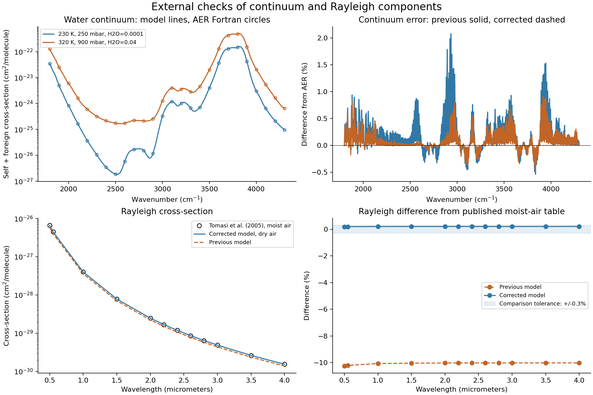

# Physics corrections and external validation

The September 2026 changes correct three identified inconsistencies: water
local-line/continuum overlap, the numerical MT_CKD continuum calculation,
and Rayleigh reference-state normalization. These are component checks;
they do not establish agreement of the complete application with MODTRAN.

## Line selection and spectral sampling (late September 2026, validation in progress)

Two further inconsistencies were measured and corrected; full method and
status are in [docs/spectral_sampling.md](docs/spectral_sampling.md).

**Line selection.** The former default kept only lines stronger than 1e-4 of
their species' strongest line. For water that threshold (2.5e-23 cm/molecule
at 296 K) exceeds every line between 2440 and 2860 cm^-1, so all 6,162 local
water lines in the 3.5-4.1 um window were discarded. Against a calculation
keeping every line (1 cm^-1 point sampling), mean window transmittance was
overstated by:

| Path | 4.5-5.0 um | 3.5-4.1 um | 2.9-3.5 um |
|---|---:|---:|---:|
| Tropical, 10 km horizontal | +5.00 pp | +23.65 pp | +3.47 pp |
| Mid-latitude summer, ground to space | +9.62 pp | +9.79 pp | +5.04 pp |
| 20 km nadir to ground | +9.87 pp | +9.81 pp | +5.04 pp |

The default is now a per-layer peak-optical-depth threshold (3e-6, chosen
from a sweep over five paths: every 1 cm^-1 window bin within 0.08 pp of
keeping every line; see docs/spectral_sampling.md#validation-results),
following LBLRTM's absolute line rejection. An independent HAPI line-by-line
reference agrees with the full model to 0.001 in window transmittance
(`tests/test_hapi_reference.py`). `tests/test_lbl_engine.py`
checks that it is an exact threshold and that the window water lines are kept.
The earlier end-to-end table below was computed with the old selection;
window values change substantially under the new default.

**Spectral sampling.** Point sampling at 1 cm^-1 on a 2 km horizontal path
(2040-2060 cm^-1) differed from line-resolved 1 cm^-1 bin averages by up to
3.76 pp (0.67 pp mean). Optional `spectral_sampling: resolved` computes on a
line-resolving grid and applies an instrument function;
`tests/test_resolved.py` checks it against an independently hand-averaged
fine-grid calculation.

**Engine rewrite.** The rewritten direct evaluation reproduces the previous
engine to 7.9e-15 relative. The optional multigrid wing interpolation agrees
with direct evaluation to 1.0e-4 relative (points above 1e-6 of the maximum)
across four windows, six species and four atmospheric states.

Not yet done: the line-selection threshold sweep, fine-step convergence,
correlated-k accuracy for DISORT/Monte Carlo, and re-baselining of window
benchmarks. See the pending list in the linked document.

## Implemented corrections

1. **Water local lines match the continuum convention.** Subtract the constant
   Lorentz value at 25 cm^-1 from the local Voigt profile inside +/-25 cm^-1.
   MT_CKD already includes this pedestal. Do not renormalize the remainder.
   With continuum enabled, water always uses this cutoff; other species retain
   the requested cutoff. Plain `absorption_cross_section` defaults to ordinary
   Voigt profiles for independent use. This follows [HITRAN's MT_CKD
   prescription](https://hitran.org/mtckd/).
2. **Continuum numerics match AER 4.3.** Apply temperature, density and radiation
   factors on the native coefficient grid, then use AER's four-point cubic
   interpolation. Preserve the reference routine's radiation constant and
   limiting branches to reproduce its numerical results. The shipped coefficient
   arrays were checked element-for-element against AER's original NetCDF file.
   Source: [AER MT_CKD_H2O 4.3](https://github.com/AER-RC/MT_CKD_H2O/tree/4.3).
3. **Rayleigh uses a consistent reference state.** The refractivity is for air
   at 288.15 K. Replace the mismatched 273.15 K number density with
   2.54743e19 molecules/cm^3 and use wavelength-dependent nitrogen/oxygen
   King factors, weighted for standard dry air. The physical prescription is
   [Bodhaine et al. (1999)](https://doi.org/10.1175/1520-0426(1999)016%3C1854:ORODC%3E2.0.CO;2).

Also fix the discrete line windows: apply the requested cutoff to the actual
pressure-shifted line center, rather than its nearest grid index. Previously
rounding admitted samples outside the declared cutoff. Clip each evaluation
window to the requested grid before allocation, keeping narrow fine-resolution
runs practical with the correct water cutoff.

## Independent numerical evidence

### Water continuum

Reference source commit: `3e043b491a996a9679c65a45a57a3ec4317e9e79` (AER tag `4.3`).
Unmodified AER routines were compiled with GNU Fortran 11.5.0 in double
precision, linked to NetCDF Fortran 4.5.4 on Rocky Linux 9. Only our driver
is new: it initializes output arrays to zero and selects the standard foreign
continuum. The calculation ran without network access.

| Case | Pressure (mbar) | Temperature (K) | H2O mole fraction | Grid (cm^-1) |
|---|---:|---:|---:|---|
| AER distributed example | 1013 | 300 | 0.00990098 | 497-603, step 1 |
| Cold/dry | 250 | 230 | 0.0001 | 1800.25-4300.25, step 2.5 |
| Intermediate | 600 | 260 | 0.005 | same |
| Reference temperature | 1013 | 296 | 0.02 | same |
| Warm/humid | 900 | 320 | 0.04 | same |

There are 4,111 spectral samples, with self and foreign coefficients tested
separately. The new implementation's maximum relative discrepancy is below
1e-14; the regression tolerance is 2e-12 with **zero absolute tolerance**.
The previous total-continuum calculation differed by up to 2.079% in these cases.

Our compiled case 1 reproduces every value in AER's distributed NetCDF example
exactly. At 497 cm^-1 its self and foreign cross-sections are respectively
3.05589121e-23 and 2.41129709e-23 cm^2/molecule (rounded here). Tests preserve
full precision, including conversion from cross-section to layer optical depth.

The H2O pedestal tests separately check the analytic subtraction, nonnegative
profiles, off-grid line centers, exact cutoff exclusion and enforcement of the
25 cm^-1 water convention. They are prescription/analytic checks, not an
independent full-spectrum LBLRTM comparison.

### Rayleigh

Independent comparison: [Tomasi et al. (2005), Applied Optics 44, Table 4](https://opg.optica.org/ao/abstract.cfm?uri=ao-44-16-3320).
The table uses a moist US Standard surface state: 1013 mbar, 288.20 K,
water partial pressure 7.85075 mbar and 385 ppm CO2. Our dry-air approximation
has slightly different composition and dispersion; the comparison tolerance is
0.3%, not numerical identity.

| Wavelength (micrometers) | Published (cm^2/molecule) | Corrected model |
|---|---:|---:|
| 0.55 | 4.4995e-27 | 4.50834521e-27 |
| 4.00 | 1.5463e-30 | 1.54958065e-30 |

All 12 tabulated comparisons from 0.5 to 4 micrometers agree within 0.213%.
The previous calculation was approximately 10% low. Rayleigh remains a small
contribution in the application's MWIR band.



## End-to-end output changes

Final regression result: **474 passed** in 161.72 seconds on Rocky Linux 9
with networking disabled. Windows passed 473 tests in the initial full run;
the replacement for the obsolete coarse-error test then passed separately.
An installed wheel also reproduced the AER example from outside the checkout.

All five shipped scenarios ran at their specified resolution, including the
0.001 cm^-1 CO-line example. Each output passed finite/range checks,
transmittance component factorization and radiance component summation.
Reference plots, before/after spectra and representative radiance plots were
visually inspected.

The baseline is commit `6bba840`. Means below are trapezoidal averages in
wavenumber over each scenario's computed window, without extra smoothing.
Changes are **percentage points**, not relative percentages.

| Scenario | Previous mean T | Corrected mean T | Mean change (pp) | Largest sample change (pp) |
|---|---:|---:|---:|---:|
| Fine CO line | 0.578690 | 0.577545 | -0.1145 | 0.1873 |
| Horizontal haze | 0.191450 | 0.192561 | +0.1111 | 5.2533 |
| Hot target | 0.376386 | 0.378629 | +0.2243 | 5.2866 |
| Limb view | 0.755233 | 0.755406 | +0.0173 | 6.6087 |
| Tropical maritime | 0.559438 | 0.560918 | +0.1480 | 3.6244 |

The largest samples in the haze/target/limb cases are near the CO2 wing edge
at 2393-2400 cm^-1 and come from enforcing the exact cutoff. They demonstrate
sensitivity of the truncated-Voigt approximation, not verified improvements
against a CO2 laboratory spectrum. The fine example now includes water lines
out to the physically required 25 cm^-1 even though its other-gas cutoff is 3.

## Reproduction and provenance

Normal offline checks require only the repository's Python dependencies:

```sh
python -m pytest tests/test_physics_references.py tests/test_lbl.py tests/test_continuum.py -q
python scripts/plot_physics_validation.py
python scripts/verify_examples.py
python -m pytest -q
```

Regenerating the reference fixtures requires git, gfortran and NetCDF Fortran.
Clone AER into `artifacts/physics-reference/MT_CKD_H2O`, check out the commit
above, and make this checkout available at `/work` in a Linux environment.
Run `bash scripts/physics_reference/run_reference.sh`, then
`python scripts/physics_reference/pack_reference.py`. The packer checks the
source commit, a clean source tree and exact agreement with AER's example.
Ordinary tests use committed NPZ fixtures and need neither Fortran nor network.

SHA-256 of original AER source data:

- `absco-ref_wv-mt-ckd.nc`: `69944eb8b045c268e2daeb2cddf536b99f9e9efe7e91c425067b46a5b287ddb3`
- `mt_ckd_h2o_output.nc`: `d06323aeefaddfd0a2d1d7895b271ccfb0887115539a465d53c493435ffad3da`

AER attribution and license are reproduced in `tests/reference_data/AER_LICENSE.md`
and in `mwir_atmos/optics/AER_LICENSE.txt`, which is included in built wheels.

## Remaining physics priorities

- CO2 line mixing, continuum/CIA and validated far wings need compatible
  published data and separate reference spectra. Band-core opacity does not
  bound band-edge error. No empirical correction was fitted to the plots.
- Original LOWTRAN 7 aerosol optical tables and background profiles are now
  available alongside the legacy parameterizations. See
  [aerosol validation](docs/lowtran_aerosols.md). Modern aerosol datasets and
  full phase tables remain future work.
- Point sampling, line pruning and path discretization still require
  convergence checks for each quantitative application. Gaussian smoothing
  cannot recover spectral structure missed by the underlying grid; use
  `spectral_sampling: resolved`, whose fine-step rule is itself pending the
  convergence study in [docs/spectral_sampling.md](docs/spectral_sampling.md).
- N2 collision-induced absorption (the 2000-2800 cm^-1 fundamental band) is
  not modelled. It affects long paths near the 4 um window edge and needs a
  published coefficient set (e.g. HITRAN CIA) with its own validation.
- Optional DISORT multiple scattering is now available; see
  [its validation and geometry limits](docs/multiple_scattering.md). Refraction
  remains omitted. Component checks are not full LBLRTM/MODTRAN validation.

## Spherical multiple scattering

The experimental `spherical_mc` option follows full spherical-shell photon paths,
including Earth shadow and repeated surface reflection. Analytic geometry/thermal
checks and the large-radius DISORT limit pass. This is not yet a full-spherical
external-code validation. See [method, uncertainty, and limits](docs/spherical_scattering.md).
