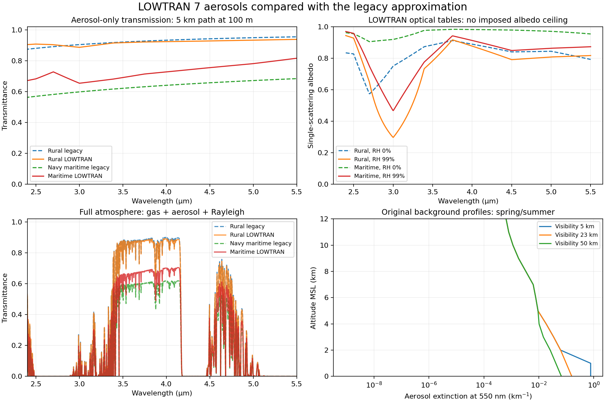

# LOWTRAN 7 table aerosols

Choose **LOWTRAN table: Rural / Urban / Maritime / Tropospheric** in the
Atmosphere sidebar. YAML and CLI use `lowtran_rural`, `lowtran_urban`,
`lowtran_maritime`, or `lowtran_tropospheric`. Existing names and the default
retain the older parametric model, so old saved calculations remain reproducible.
The new choices also work with saved setups, overrides and distance sweeps:

```python
from mwir_atmos.setups import load_setup, sweep_distance

setup = load_setup("my_setup.yaml", aerosol="lowtran_maritime", visibility_km=23.)
result = sweep_distance(setup, [1., 2., 3., 4.], threshold=.5,
                        metric=lambda r: float(r.transmittance.total.mean()))
```

That example is a mean-transmittance threshold; replace the metric with a
detector/SNR model for detectability. A visibility input describes meteorological
visibility, not the target distance being swept.

## Data and calculation

The offline tables come from the original **LOWTRAN 7 revision 4.2, February
1992** source maintained in [space-physics/lowtran](https://github.com/space-physics/lowtran),
commit `5b8d38714b204eaa12595f5f15e2babec1dbdfb5`. Exact source SHA-256, units and
humidity nodes are recorded in `data/aerosol/provenance.json`. The archive's
MIT notice is distributed in `data/aerosol/LOWTRAN_LICENSE.txt`, including in
wheels. This is a specific historical LOWTRAN dataset, not a claim of equivalence
to a current MODTRAN release.

- **Optical properties:** `EXTDTA` tabulates extinction, absorption and asymmetry
  at 47 wavelengths and RH 0, 70, 80 and 99%. The implementation uses 0.2–40 µm
  (40 nodes), avoiding the original microwave branch. Extinction and absorption
  share normalization by extinction at 550 nm. Scattering is extinction minus
  absorption, without an imposed single-scattering-albedo ceiling.
- **Interpolation:** the original `EXABIN` algorithm interpolates the logarithm
  of each property against `log(100 − RH)` at native wavelengths. `AEREXT` then
  interpolates linearly in wavelength. RH is bounded to 0–99%.
- **Vertical loading:** original `AERPRF` background extinction profiles at
  550 nm use inverse-visibility interpolation. Visibility is restricted to the
  tabulated 2–50 km range; extrapolation is rejected. At 23 km visibility the
  surface aerosol extinction is **0.158 km⁻¹**. These profiles already represent
  aerosol, so the model does not add another Koschmieder normalization or
  humidity-growth multiplier. At fixed visibility, RH changes spectral shape
  and albedo while 550-nm loading remains fixed.
- **Altitude regions:** the selected aerosol occupies 0–2 km MSL; 2–10 km uses
  tropospheric optics at the original fixed 70% RH; 10–30 km uses background
  stratospheric optics; 30–100 km uses meteoric dust. Above 100 km aerosol is
  zero. Midlatitude/subarctic winter atmospheres select fall/winter profiles;
  other atmospheres select spring/summer. Low-level callers can set `winter`
  on `aerosol_optical_depth`, or `aerosol_winter` on `compute_layer_optics`.
- **Layer integration:** extinction is log-linear between native altitude
  nodes. Layers are split at nodes/region boundaries and integrated analytically
  assuming altitude varies linearly along each geometry layer. Asymmetry is
  weighted by scattering optical depth. Layer RH remains the geometry layer's
  mean; refine layers to resolve humidity gradients. Profiles use altitude
  above sea level, with no terrain-following boundary-layer relocation.
- **Rayleigh:** the existing density-scaled dry-air cross section, wavelength
  dependent King factor and separate Rayleigh phase function remain enabled.
  Only aerosol absorption produces aerosol thermal emission. Aerosol scattering
  and molecular Rayleigh scattering retain separate optical-depth components.

Ordinary maritime here is the original maritime table, **not the wind-dependent
Navy Aerosol Model**. Wind does not alter table aerosols. Desert, volcanic-event,
fog and cloud table options are not implemented. The original named legacy
models remain available for comparison.

## Validation

`scripts/physics_reference/extract_lowtran_aerosols.py` checks the pinned revision
and rejects modified source, extracts the offline tables, and copies unmodified
`EXABIN`, `AEREXT`, `AERPRF`, `EXTDTA` and `PRFDTA` into an ignored build directory.
`lowtran_aerosol_driver.f90` calls those original routines. Its GAMFOG link guard
stops if the excluded microwave branch is reached. The reference calculations
use original single-precision REAL arithmetic; the Python backend uses float64.

The committed reference fixtures contain **5,376 spectral cases** (four aerosol
choices, seven RH values, 48 native/interior wavelengths, four altitude regions)
and **462 profile cases** (two seasons, seven visibilities, 33 altitude nodes).
Maximum relative discrepancies are **3.23 × 10⁻⁶** for spectral properties and
**1.83 × 10⁻⁷** for profiles. They are consistent with single-precision arithmetic
and wavelength/wavenumber round trips. Tests also check layer-split conservation
of absorption, scattering and phase moments, horizontal paths, reversed paths,
upper-atmosphere clipping, physical albedo, YAML round trips and input bounds.

Reference regeneration (from the repository root, with gfortran installed):

```sh
python scripts/physics_reference/extract_lowtran_aerosols.py artifacts/lowtran-reference
cd artifacts/lowtran-reference-kernel
gfortran -std=legacy -O0 -o reference original.f ../../scripts/physics_reference/lowtran_aerosol_driver.f90
./reference
```

The NPZ fixtures in `tests/reference_data` store the resulting CSV numeric rows
as structured arrays under key `data`. They require no compiler or internet to
run. The aerosol data and license are also included in installed wheels.

## Remaining limits

This validates the aerosol component against LOWTRAN source routines. It does
not validate full atmospheric radiance or transmittance against MODTRAN. The
current radiance solver still uses single scattering and a Henyey–Greenstein
aerosol phase function from table g; it does not reproduce LOWTRAN's full phase
tables or a multiple-scattering solver. Higher-scattering cases make those
radiance limitations more consequential. Direct-beam transmittance includes
both absorption and scattering losses. Refraction remains omitted.

See [existing Rayleigh reference checks](../PHYSICS_VALIDATION.md#rayleigh) and
[MODTRAN's documented aerosol and scattering capabilities](https://modtran.spectral.com/modtran_features)
for the distinction between this component implementation and the full model.

## Scenario comparison



Generated by `scripts/physics_reference/plot_lowtran_aerosols.py`: full scenario
runs at 100 m altitude, 5 km slant range, 23 km visibility and 75% surface RH.
The maritime curves compare two different formulations (legacy Navy approximation
and ordinary LOWTRAN maritime); their difference is not an error estimate.
