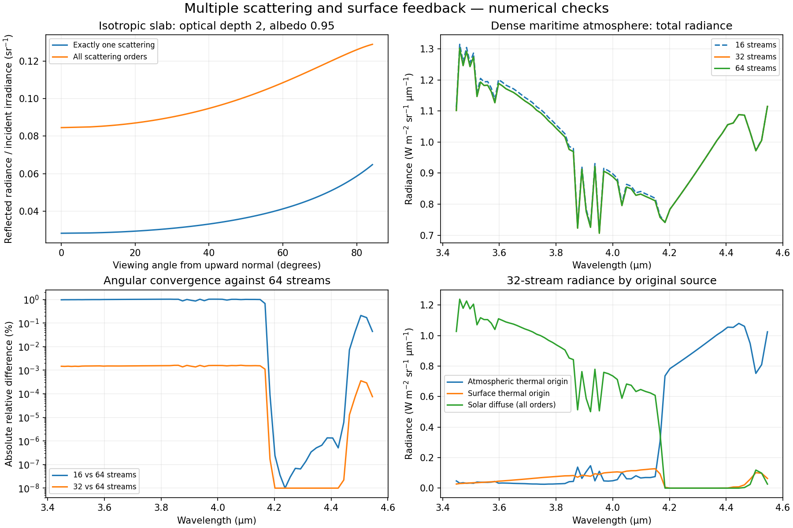

# Multiple-scattering radiance

Select **Radiance solver → DISORT multiple scattering (plane-parallel)** in
the sidebar. The default is 32 angular streams; 8, 16 and 64 are also available.
The existing single-scattering mode remains the default for older setups.

```yaml
radiance_solver: disort
disort_streams: 32
aerosol: lowtran_maritime
visibility_km: 23.0
sensor_alt_km: 0.1
sensor_zenith_deg: 90.0
source_range_km: 5.0
```

The same fields work through the CLI (`--radiance-solver disort
--disort-streams 32`), saved YAML, `load_setup(..., radiance_solver="disort")`,
and distance sweeps. A horizontal view requires a finite source range.

## What is solved

The calculation solves the scalar, monochromatic radiative-transfer equation
in a vertically layered, horizontally uniform atmosphere. All scattering orders
are included through a discrete-ordinate boundary-value solution. The angular
field includes:

- Molecular absorption and thermal emission, aerosol absorption and thermal
  emission, aerosol scattering, and Rayleigh scattering.
- A collimated solar beam and a collimated lunar beam, solved separately and
  added by linear superposition.
- Thermal emission from the lower boundary and repeated reflection of direct
  and diffuse radiation between the atmosphere and a Lambertian ground.
- The complete atmosphere from the ground to 100 km, including atmospheric
  layers outside the sensor-to-target path. Those layers can illuminate the
  viewing path or the ground.

Extinction optical depth sets attenuation; single-scattering albedo is
scattering divided by total extinction. Only true absorption contributes to
thermal emissivity, through `(1 − omega) B`. Aerosol phase moments are
Henyey–Greenstein `beta_l = g**l`. The scalar Rayleigh phase has `beta_0 = 1`,
`beta_2 = 0.1`; other moments vanish. The two are weighted by their scattering
optical depths before solving. No absorption-dominance assumption is imposed.

Atmospheric slabs use the existing gas-column integration, effective gas
pressures/temperatures, and LOWTRAN aerosol tables. Each radiative-transfer slab
is isothermal at its effective layer temperature. Surface-refined vertical
layers and explicit sensor/endpoint boundaries are retained.

The ground albedo is `1 − emissivity`, enforcing an opaque Lambertian boundary.
The scalar emissivity comes from the existing surface model's nadir value or
the explicit override. This is a surface-property approximation, including
for sea water: this mode does not use a Fresnel/specular ocean BRDF.

## Geometry and finite targets

DISORT mode uses **plane-parallel geometry for both transmittance and radiance**.
Slant optical paths are obtained from the same vertical slabs by secant scaling.
A finite horizontal path stays at constant altitude within its atmospheric slab.
This preserves a consistent radiative-transfer medium; it does not combine a
spherical line of sight with an incompatible flat-atmosphere angular field.

The observer radiance is calculated by formal integration of the solved diffuse
source along the line of sight. Thermal and direct-beam scattering contributions
are integrated analytically within each slab. The remaining diffuse source uses
16-point Gaussian quadrature, with intervals no larger than 0.5 extinction optical
depth. Contributions beyond 32 optical depths from the sensor are negligible at
the specified attenuation cutoff (`exp(-32) ≈ 1.27e-14`). Horizontal paths use
the constant local source times `1 − exp(-tau_LOS)`.

A finite endpoint has zero incident background unless `source_temp_k` specifies
a target radiance. The target contributes its emissivity times Planck radiance,
attenuated by the line-of-sight extinction. It replaces the endpoint background;
it is not added a second time to ground emission. The target is a local boundary
condition and does not illuminate or obstruct the entire horizontally uniform
atmosphere. Target reflection, target-induced changes to the global radiation
field, and spatial redistribution of a resolved target image are not modeled.

Direct solar/lunar discs are added separately for unobstructed views to space.
Their attenuation uses the full column above the sensor, not just a partial
sensor-to-target column. Illumination below the flat horizon is excluded.

## Reading the components

Components are separated by **original photon source**, not by the last event:

| Field | Meaning in DISORT mode |
|---|---|
| `path_thermal` | Atmospheric thermal origin, including subsequent scattering and ground reflection |
| `surface_emitted` | Ground thermal origin, including subsequent scattering and reflection |
| `solar_multiple_scatter` | All diffuse solar-origin radiance, including direct ground reflection and repeated scattering |
| `lunar_multiple_scatter` | All diffuse lunar-origin radiance, including ground reflection and repeated scattering |
| `direct_solar`, `direct_lunar` | Unscattered celestial-disc radiance |
| `source_emitted` | Prescribed target radiance through the viewing-path extinction |

The legacy single-scatter and surface-reflected fields are zero in this mode
to avoid double counting. Every component is still present as an array in
CSV/JSON/NPZ output, and their sum equals `total`. Legacy runs zero-fill the two
new multiple-scattering fields.

## Numerical validation and provenance

The solver is the MIT-licensed [PythonicDISORT](https://github.com/LDEO-CREW/Pythonic-DISORT),
described in [Ho (2024), JOSS 9(103), 6442](https://doi.org/10.21105/joss.06442),
based on Stamnes et al.'s DISORT method. The vendored revision is
`febb19f290a2ad860f74922d58d2f719e2fde771`. Only package imports were renamed;
the numerical routines are unchanged. Original source hashes and the license
are included in `mwir_atmos/_vendor/pythonic_disort/` and in installed wheels.
Runtime requires only the existing NumPy/SciPy dependencies and no network.

`tests/reference_data/disort/` contains seven upstream **Stamnes DISORT 4.0.99**
reference cases with their exact inputs: 1a, 1d, 2a, 2d, 7a, 8a and 9c. These
exercise isotropic and Rayleigh scattering, thin/thick media, thermal emission,
multilayer transfer, a beam and a reflecting/emitting ground. They are independent
Fortran outputs supplied by upstream, not fixtures calculated by this project.
Fluxes and directional radiances are tested with relative tolerance 0.2% plus
small absolute tolerances for the original single-precision zero residuals.

The importer is reproducible:

```sh
git clone https://github.com/LDEO-CREW/Pythonic-DISORT artifacts/pythonic-disort-reference
git -C artifacts/pythonic-disort-reference checkout febb19f290a2ad860f74922d58d2f719e2fde771
python scripts/physics_reference/import_disort_references.py artifacts/pythonic-disort-reference
python -m pytest tests/test_multiple_scattering.py
```

Additional tests verify conservative flux balance, the exact pure-absorption
solution, the horizontal-source limit, scattering-phase mixing, Lambertian
beam-reflection units and angles, finite-target replacement, and formal viewing
path integration against a DISORT quadrature direction. Integration tests exercise
real atmospheres, serialization, distance scaling, UI selection and exports.

The kernel requires albedo below unity. Exactly conservative layers are evaluated
at `1 − 1e-10`; flux conservation is tested to relative tolerance `2e-7` in a
three-optical-depth slab over a reflecting ground. Numerically transparent slabs
receive a minimum extinction depth of `1e-12`. Small negative roundoff residuals
are zeroed; significant negative radiance raises an error requesting more streams.

## Convergence and limitations

Increasing streams is necessary for strongly forward-peaked aerosols and
near-beam viewing angles. This adapter currently uses unscaled Legendre moments,
without delta-M scaling or Nakajima–Tanaka corrections. Use 32 versus 64 streams
to assess angular convergence for each quantitative application; a low-stream
run is not automatically accurate. The source tables' HG approximation is also
different from a full measured/Mie phase function.

This is **full multiple scattering within a scalar 1D plane-parallel model**.
For curved-shell transport, use the separate experimental [spherical Monte Carlo solver](spherical_scattering.md).
DISORT mode is not full MODTRAN equivalence, polarized transfer, a 3D cloud/terrain solver,
or spherical/pseudo-spherical multiple scattering. Near-horizon, limb and long
horizontal paths require particular care because Earth curvature and refraction
are omitted in this mode. Solar/lunar spectra and surface optical properties
retain the existing approximations. Gas spectroscopy limitations are unchanged.

Multiple scattering does not recover unresolved spectral lines. Spectral,
vertical-layer and angular convergence are separate checks. Per-wavenumber
angular solves are sequential and use bounded working memory, but high stream
counts can add substantial runtime. The interface cost estimate includes this
additional work.



Generated by `scripts/physics_reference/plot_multiple_scattering.py`. The left
upper panel isolates scattering order in an isotropic slab. Other panels use
the same dense maritime plane-parallel scenario at different stream counts.
Measured runtime and spectral convergence are recorded in
`multiple_scattering_checks.json`; these are sample checks, not global error bounds.
