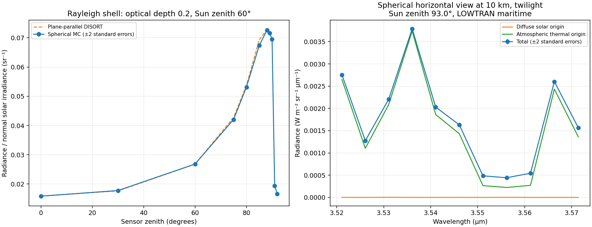

# Spherical multiple-scattering radiance

Select **Radiance solver → Spherical multiple scattering (Monte Carlo)**.
This experimental scalar solver follows every photon path through concentric
atmospheric shells, including paths between scattering events, illumination
paths, and reflections from the spherical ground. It does not approximate the
diffuse field with a plane-parallel DISORT column.

```yaml
radiance_solver: spherical_mc
spherical_photons: 4096
spherical_seed: 0
spherical_max_events: 256
sensor_alt_km: 0.1
sensor_zenith_deg: 90.0
```

The same fields work in saved setups, Python overrides, and distance sweeps.
CLI flags are `--radiance-solver spherical_mc`, `--spherical-photons`,
`--spherical-seed`, and `--spherical-max-events`. Horizontal views can reach
space without a finite target, because their altitude increases along the ray.
Sensors must currently lie between the surface and the profile top (100 km).
Start with a narrow spectral window; each spectral point runs separate histories.

## Physics and algorithm

This is an independent implementation of backward Monte Carlo with local
estimates, a method used for spherical transfer by
[Emde and Mayer (2007), ACP 7, 2259–2270](https://doi.org/10.5194/acp-7-2259-2007).
The [libRadtran manual](https://www.libradtran.org/doc/libRadtran.pdf) describes
the related MYSTIC approach. This implementation is not MYSTIC and has not yet
been cross-validated against MYSTIC or another full spherical transfer code.

A history starts at the observer and travels backward along the viewing ray.
Analytic ray–sphere intersections divide that ray into homogeneous segments.
Optical depth to the next interaction is exponentially distributed. At each
interaction, the history's weight is multiplied by the single-scattering albedo;
the new direction is sampled from the exact scalar phase-function mixture.
This represents absorption without randomly killing most histories in opaque
bands. Thermal emission along each free flight is integrated analytically.

Rayleigh scattering uses `P(cos θ) = 3/4 (1 + cos² θ)`. Aerosols use the
Henyey–Greenstein function with the existing wavelength/layer-dependent asymmetry
parameter. Mixture probabilities are the aerosol and molecular fractions of
scattering optical depth. No Legendre truncation or angular-stream approximation
is used in this solver; photon count controls Monte Carlo sampling instead.

At every scattering location, direct Sun/Moon contributions use their phase
function, normal irradiance divided by `4π`, and an independent spherical
transmission calculation toward the source. Ground intersections block the beam.
The body's direction is constant in global Cartesian coordinates, while its local
zenith angle changes with position. The observer's local `above_horizon` flag
does not disable atmospheric illumination: upper layers can remain sunlit at
twilight. A scenario date is required to supply physical Sun/Moon positions.

The ground is an opaque Lambertian sphere with albedo `1 − emissivity`.
Its emissivity uses the existing surface model's nadir value or the explicit
override. Surface thermal emission and direct-beam reflection are integrated
with their exact first-flight attenuation. Reflected diffuse paths are sampled
with a cosine-weighted outgoing hemisphere and can scatter or reflect again.

The line of sight and the Monte Carlo paths share the same shell optical
coefficients, derived from full-column gas/aerosol/Rayleigh optical depths divided
by shell thickness. This differs from the legacy solver's independently
integrated slant-path effective properties. Shells are isothermal; increasing
photon count does not reduce vertical discretization or spectroscopy error.

## Finite targets and components

Finite source ranges/altitudes stop only the initial viewing path. A prescribed
target contributes attenuated emissivity times Planck radiance, replacing its
endpoint background. It does not illuminate or obstruct the global atmosphere;
target reflection and spatial image redistribution are not modeled. Subsequent
scattered paths explore the full shell atmosphere, including outside the finite
viewing segment. Unscattered celestial discs are added only for unobstructed
views to space, with spherical beam attenuation.

Component meanings match [DISORT's source-origin decomposition](multiple_scattering.md):
`path_thermal`, `surface_emitted`, `solar_multiple_scatter`, and
`lunar_multiple_scatter` include later scattering/reflection of their original
source. Legacy single-scattering and surface-reflected fields remain zero to
avoid double counting. `source_emitted` and direct-disc terms are separate.

## Sampling uncertainty and convergence

The UI reports the largest relative standard error of total radiance in the
spectrum. `result.radiance.sampling_standard_error` contains spectral arrays for
the four source origins and `total`. These are uncertainties, not extra radiance
components. Total uncertainty includes covariance between source origins.
CSV/NPZ exports contain `radiance_stderr_*`; JSON contains
`radiance_sampling_standard_error`. Units match the radiance arrays.

Each estimate uses complete independent photon histories. Up to 4096 histories
are processed at once to bound working memory; their sample variances and means
are combined across batches. The fixed seed makes runs reproducible. Different
spectral points use different random seeds; no spectral smoothing is applied.

Sampling error typically decreases as `1/sqrt(N)`: four times as many histories
roughly halves it. Check both larger counts and different seeds. Standard errors
are estimated from sampled histories and are not guaranteed error bounds; rare
unsampled contributions can give a misleadingly small or zero error, especially
for twilight, weak scattering, or near-forward aerosol radiance. Band-integrated
uncertainties are not currently calculated. Sampling error excludes errors in
geometry assumptions, spectroscopy, phase functions and surface properties.

Low-weight histories use unbiased Russian roulette below weight `0.001`:
survival probability is `weight/0.001`, and surviving weight becomes `0.001`.
There is no fixed scattering-order truncation. If any live history reaches the
safety event limit, the run raises an error instead of returning a truncated
estimate; raise `spherical_max_events` for such optically thick cases.

## Checks and remaining limits

Tests cover analytic shell chord lengths, altitude-dependent Earth shadow,
exact absorption-only radiance in upward/horizontal/downward directions,
Lambertian reflection units, phase-function sampling moments, finite targets,
reproducibility, serialization, exports, and UI controls. A large-radius limit
is compared with the independently implemented, reference-tested DISORT solver
for Rayleigh and forward-peaked aerosol multiple scattering over reflecting
ground; differences must lie within five sampling standard errors plus a small
geometric/interpolation allowance. These checks do not establish a global
accuracy bound for full spherical scenarios.



Reproduce with `python scripts/physics_reference/plot_spherical_scattering.py`.
The JSON beside the plot records its numerical values and standard errors.
The idealized Rayleigh shell illustrates the horizon/ground transition; the
real-atmosphere example runs a horizontal view from 10 km at twilight.

Remaining approximations: scalar intensity (no polarization), straight rays
(no refraction), a radially uniform atmosphere and surface, no terrain/cloud
inhomogeneity, HG aerosol phase functions, approximate ephemerides and existing
gas/continuum data. Curvature is modeled, but these limitations can still matter
for accurate horizon or limb predictions. Above-atmosphere sensors and validation
against published full-spherical benchmark radiances remain future work.
